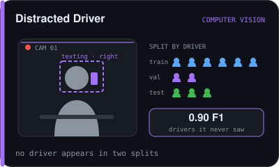
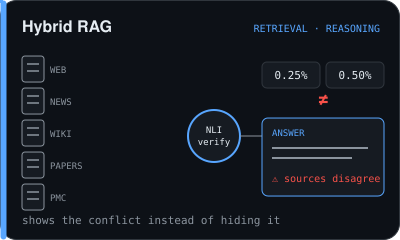
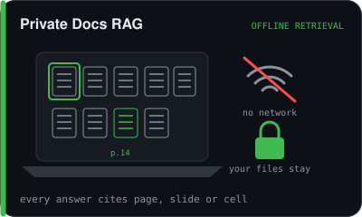
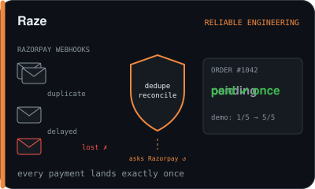
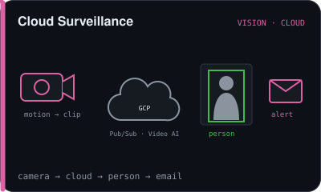
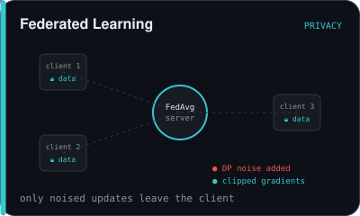
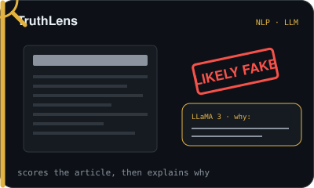
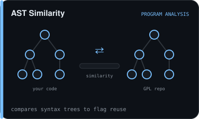
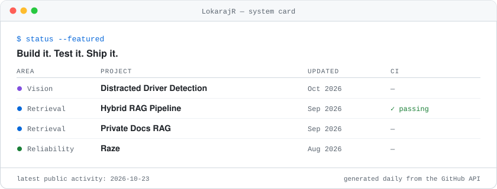

<picture>
  <source media="(prefers-color-scheme: dark)" srcset="assets/header-dark.svg">
  
</picture>

<b>B.Tech CSE (AI & ML) @ SRMIST</b> · open to <b>ML / AI engineering internships</b> 
<samp><a href="Resume.pdf">résumé</a> · <a href="https://lokarajr.github.io/Portfolio/">portfolio</a> · <a href="https://www.linkedin.com/in/lokarajr/">linkedin</a></samp>

## ♟ Play me: community chess

<table>
<tr>
<td valign="top" width="55%">

<!-- CHESS:START -->

<b>Black to move</b> · game 1, move 1 · last: <b>f4</b> by @LokarajR

 
 
 
 
 
 
 

<b>White captured</b> none yet <b>Black captured</b> none yet

<b>Players</b> <a href="https://github.com/LokarajR">@LokarajR</a>

Click a black piece, then click where it should go. Anyone can play: each move is a GitHub issue, checked for legality by <a href="scripts/chess_game.py">a workflow</a>.

<!-- CHESS:END -->

</td>
<td valign="top" width="45%">

<b>My GitHub contributions, eaten by a snake</b>
<picture>
  <source media="(prefers-color-scheme: dark)" srcset="https://raw.githubusercontent.com/LokarajR/LokarajR/output/github-snake-dark.svg">
  
</picture>

<b>LeetCode</b>
<picture>
  <source media="(prefers-color-scheme: dark)" srcset="https://leetcard.jacoblin.cool/AZF12FQrNh?theme=dark&font=Fira%20Code&ext=heatmap">
  
</picture>

</td>
</tr>
</table>

## What I've built

Each picture acts out what the project does. Click one to open the repo.

<table>
<tr>
<td width="50%"></td>
<td width="50%"></td>
</tr>
<tr>
<td width="50%"></td>
<td width="50%"></td>
</tr>
<tr>
<td width="50%"></td>
<td width="50%"></td>
</tr>
<tr>
<td width="50%"></td>
<td width="50%"></td>
</tr>
</table>

<picture>
  <source media="(prefers-color-scheme: dark)" srcset="assets/system-card-dark.svg">
  
</picture>

<b>Proof: the numbers behind the pictures</b>

 

| Project | Result | Source |
|---|---|---|
| Distracted Driver | **0.90** macro F1 on unseen drivers, vs **0.99** on a leaky random split | [`results.json`](https://github.com/LokarajR/Distracted-Driver-Detection-PS48/blob/main/outputs/results.json) |
| Private Docs RAG | keyword and figure questions rank **#1** up to 1,003 docs; **10k files** ingested in **78 s** | [`EVAL.md`](https://github.com/LokarajR/Private-Docs-RAG/blob/master/docs/EVAL.md) · [`SCALE.md`](https://github.com/LokarajR/Private-Docs-RAG/blob/master/docs/SCALE.md) |
| Hybrid RAG | conflict precision **5/6** (hand-labelled); CI passing | [README](https://github.com/LokarajR/Hybrid-RAG-pipeline#status) |
| Raze | demo: unprotected **1/5**, protected **5/5** | [README §9](https://github.com/LokarajR/Raze#9-evidence-you-can-re-run) |

<samp>PyTorch · sentence-transformers · Qdrant · FastAPI · Node.js · PostgreSQL · Docker · GCP</samp>

